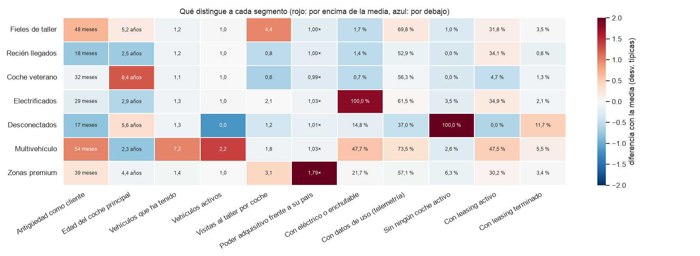
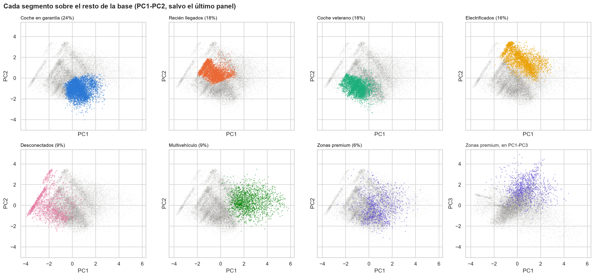

# Clustering the Star · Segmentación de clientes de Mercedes-Benz

Nuestra solución al reto de **Mercedes-Benz Group Services Madrid** en el **III Malackathon 2026** (Universidad de Málaga). Hicimos los cuatro retos básicos y tres avanzados en una jornada.

**Equipo Benji:** Víctor Tirado · Alfonso del Álamo · Vicente Díaz

📄 [Informe completo (PDF)](informe/informe.pdf) · 📊 [Dashboard de segmentos](https://viiktor08.github.io/Malackathon2026/outputs/dashboard_segmentos.html) · 📝 [Resumen de resultados](docs/resumen.md)

## El reto

Había que segmentar la base de clientes de Mercedes-Benz en Suiza y Austria con aprendizaje no supervisado, para que marketing pudiera personalizar ofertas de vehículos, planes de mantenimiento, campañas de fidelización y comunicaciones. Partíamos de una tabla con unas 300.000 filas que mezclaba datos del cliente, de sus vehículos (incluida la telemetría), de su relación con la marca, de sus consentimientos y del poder adquisitivo de su zona.

> Los datos son reales y propiedad de Mercedes-Benz, así que **no están en el repositorio**. Los notebooks se ven con sus resultados ya calculados, pero no se pueden volver a ejecutar sin el dataset.

## Cómo lo hicimos

| Paso | Notebook | Qué hicimos |
|---|---|---|
| 1 · Exploración y calidad | [`01_eda_calidad`](notebooks/01_eda_calidad.ipynb) | EDA y una lista de problemas de calidad, cada uno con su decisión: valores por defecto, nulos de motor, cuentas con más de 20 vehículos, columnas que repiten lo mismo… |
| 2 · Features | [`02a_features_cliente`](notebooks/02a_features_cliente.ipynb), [`02b_pipeline`](notebooks/02b_pipeline.ipynb) | Pasar de una fila por vehículo a **una fila por cliente** (173.456 clientes) y un pipeline de scikit-learn con 28 variables |
| 3 · K-Means | [`03_kmeans`](notebooks/03_kmeans.ipynb) | Elegir *k* con el codo, silhouette, Davies-Bouldin y la estabilidad entre semillas. Nos quedamos con **k = 7** |
| 4 · Interpretación | [`04_interpretacion`](notebooks/04_interpretacion.ipynb) | Una ficha por segmento, con una acción de marketing en cada una de las cuatro palancas, y el dashboard |
| A1 · Comparativa | [`05_comparativa`](notebooks/05_comparativa.ipynb) | Comparar con GMM (covarianza diagonal y completa), Agglomerative (Ward) y DBSCAN |
| A2 · PCA | [`06_pca`](notebooks/06_pca.ipynb) | Qué significa cada componente y cómo se reparten los segmentos en ese espacio |
| A3 · Jackknife | [`07_jackknife`](notebooks/07_jackknife.ipynb) | 20 submuestras, cada una sin un 15 % de los clientes, reentrenando el pipeline entero |

## Los 7 segmentos

| Segmento | Clientes | Qué le define | Acción |
|---|---|---|---|
| Coche en garantía | 24,1 % | Coche de unos 5 años que llega al final de la garantía y la ha usado mucho | Retener |
| Recién llegados | 18,3 % | Año y medio como clientes y coche casi nuevo | Vincular |
| Coche veterano | 18,2 % | Coche de más de 8 años y casi sin leasing | Renovar |
| Electrificados | 15,9 % | Todos tienen un eléctrico o un enchufable | Acompañar |
| Desconectados | 9,0 % | Ningún coche activo: posible fuga | Recuperar |
| Multivehículo | 8,8 % | Unos 7 vehículos de media; aquí están casi todas las cuentas grandes | Ampliar |
| Zonas premium | 5,6 % | Zonas con 1,8 veces el poder adquisitivo típico de su país | Elevar |

<p align="center">
  
  
</p>

## Lo que sacamos en claro

- **Los segmentos son estables:** con el Jackknife, de media el 99,8 % de los clientes se queda en su segmento, y *k* = 7 sale más estable que *k* = 6 y *k* = 8.
- **Hay dos tipos de segmentos.** Los que tienen un rasgo muy claro (Electrificados, Desconectados, Multivehículo y Zonas premium) aparecen con cualquier algoritmo. Los del ciclo de vida del coche dependen más del método.
- **Los clientes forman un continuo, no islas.** El silhouette es bajo (0,13), DBSCAN mete a casi todos en un solo grupo y el PCA no muestra grupos separados. Los segmentos son cortes útiles de ese continuo, no grupos naturales.

## Estructura

```
notebooks/    Un notebook por reto, ya ejecutado
src/          Limpieza, pipeline, clustering, perfiles y generador del dashboard
tests/        Tests de los perfiles, los segmentos y el dashboard
outputs/      Figuras y dashboard en HTML
informe/      Informe en LaTeX y PDF
docs/         Resumen de resultados
```

## Ejecutarlo

```sh
python -m venv .venv && source .venv/bin/activate
pip install -r requirements.txt -r requirements-dev.txt
pytest                       # no necesitan el dataset: solo se salta uno, que usa los resultados
```

Para volver a ejecutar los notebooks hace falta el CSV del reto en la raíz del repositorio, con el nombre `datos_reto_mercedes_benz_malackathon.csv`. El `.gitignore` impide subirlo.
